<!-- HEADER -->

 

 

---

<!-- ABOUT ME -->

## About Me

I'm **Le Van Cuong**, an Information Technology student at
**East Asia University of Technology (EAUT), Vietnam**.

I am pursuing a career in **AI Engineering and Software Development**,
with interests in applied artificial intelligence, intelligent agents,
natural language processing, and software architecture.

- Currently conducting undergraduate research in Vietnamese NLP and semantic similarity.
- Developing AgentReady B2A, an experimental toolkit for AI-readable commerce data.
- Learning about LLMs, Machine Learning, AI Agents, MCP, and software system design.
- Interested in open-source development, research collaboration, and practical AI applications.
- Enjoy exploring open-source repositories and turning ideas into useful software.

---

<!-- CURRENT FOCUS -->

## Research & Development Focus

| Domain | Research & Development Interests |
| :--- | :--- |
| Artificial Intelligence | Machine Learning, intelligent systems |
| Natural Language Processing | Vietnamese NLP, semantic similarity, embeddings |
| AI Agents | Agent Skills, MCP, agent-oriented applications |
| Computer Vision | Image processing, stereo vision, 3D reconstruction |
| Software Engineering | System architecture, backend development, automation |
| Open Source | Developer tools, reusable software, collaboration |

---

<!-- RESEARCH -->

## Scientific Research

### Vietnamese Semantic Similarity Research

Research on intelligent semantic similarity and academic text analysis
for higher education.

**Research directions:**

- Semantic duplication detection
- Essay assessment support
- Curriculum mapping
- Vietnamese text representation and similarity evaluation

**Research interests:** Sentence Transformers, semantic embeddings,
Vietnamese language models, and evaluation methodologies.

[Explore Research Repository](https://github.com/cuonghuhuu/vietnamese-semantic-similarity-research)

---

<!-- FEATURED PROJECTS -->

## Featured Projects

| Project | Description |
| :--- | :--- |
| [AgentReady B2A](https://github.com/cuonghuhuu/agentready_B2A) | Experimental developer toolkit for making public commerce data more accessible to compatible AI agents. |
| [Vietnamese Semantic Similarity](https://github.com/cuonghuhuu/vietnamese-semantic-similarity-research) | Undergraduate research in Vietnamese semantic similarity and academic text analysis. |
| [AI Smart Meal Planner](https://github.com/cuonghuhuu/ai-smart-meal-planner) | Intelligent meal planning application using Flutter, Java Spring Boot, MySQL, and Python. |
| [GitHub Contribution Analyzer](https://github.com/cuonghuhuu/he-thong-danh-gia-dong-gop-github-bang-AI) | Python-based repository contribution analysis, visualization, and reporting tool. |

---

<!-- TECH STACK -->

## Technology Stack

Technologies used or explored across my development projects.

| Area | Technologies used or explored |
| :--- | :--- |
| Languages |  |
| AI & Vision |  |
| Web & Backend |  |
| Mobile & Data |  |
| Engineering Tools |  |

### Currently Exploring

---

<!-- GITHUB STATISTICS -->

## GitHub Analytics

 

---

<!-- ACTIVITY GRAPH -->

## Contribution Activity

---

<!-- CONTRIBUTION ANIMATION -->
 
## Contribution Animation

  

<picture>
  <source media="(prefers-color-scheme: dark)" srcset="https://raw.githubusercontent.com/cuonghuhuu/cuonghuhuu/output/github-contribution-grid-snake-dark.svg">
  <source media="(prefers-color-scheme: light)" srcset="https://raw.githubusercontent.com/cuonghuhuu/cuonghuhuu/output/github-contribution-grid-snake.svg">
  
</picture>

Generated from GitHub contribution history and refreshed daily.

[View animation workflow](https://github.com/cuonghuhuu/cuonghuhuu/actions/workflows/snake.yml)

---

<!-- CONNECT -->

## Connect With Me

  

<i>Keep learning. Keep building. Keep improving.</i>

<!-- FOOTER -->

