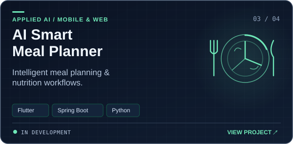
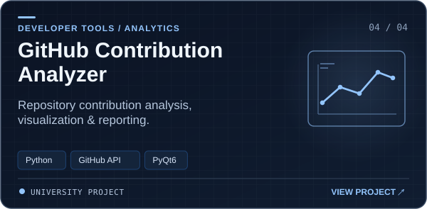

<!-- HEADER -->

 

 

---

<!-- ABOUT ME -->

## About Me

I'm **Le Van Cuong**, an IT student at **East Asia University of Technology (EAUT), Vietnam**, pursuing AI engineering and software development.

I focus on applied AI, Vietnamese NLP, agent systems, developer tooling and maintainable software architecture. Currently conducting undergraduate research on semantic similarity and developing AgentReady B2A, an experimental agent-oriented developer toolkit.

---

<!-- FEATURED PROJECTS -->

## Featured Projects

Selected research and development work. Each card opens its repository.

 

[Browse all repositories](https://github.com/cuonghuhuu?tab=repositories)

---

<!-- CURRENT FOCUS -->

## Engineering & Research Interests

| Domain | Research & Development Interests |
| :--- | :--- |
| Artificial Intelligence | Machine Learning, intelligent systems |
| Natural Language Processing | Vietnamese NLP, semantic similarity, embeddings |
| AI Agents | Agent Skills, MCP, agent-oriented applications |
| Computer Vision | Image processing, stereo vision, 3D reconstruction |
| Software Engineering | System architecture, backend development, automation |
| Open Source | Developer tools, reusable software, collaboration |

---

<!-- RESEARCH -->

## Scientific Research

### Vietnamese Semantic Similarity Research

Research on intelligent semantic similarity and academic text analysis
for higher education.

**Research directions:**

- Semantic duplication detection
- Essay assessment support
- Curriculum mapping
- Vietnamese text representation and similarity evaluation

**Research interests:** Sentence Transformers, semantic embeddings,
Vietnamese language models, and evaluation methodologies.

[Explore Research Repository](https://github.com/cuonghuhuu/vietnamese-semantic-similarity-research)

---

<!-- TECH STACK -->

## Technology Stack

Technologies used or explored across my development projects.

| Area | Technologies used or explored |
| :--- | :--- |
| Languages |  |
| AI & Vision |  |
| Web & Backend |  |
| Mobile & Data |  |
| Engineering Tools |  |

### Currently Exploring

---

<!-- GITHUB STATISTICS -->

## GitHub Analytics

  <picture><source media="(prefers-color-scheme: dark)" srcset="https://github-readme-stats.vercel.app/api?username=cuonghuhuu&amp;show_icons=true&amp;hide_rank=true&amp;card_width=420&amp;custom_title=GitHub%20Overview&amp;title_color=67E8F9&amp;text_color=B9CAE3&amp;icon_color=A78BFA&amp;bg_color=0B1323&amp;border_color=33445D"/></picture>
  <picture><source media="(prefers-color-scheme: dark)" srcset="https://github-readme-stats.vercel.app/api/top-langs/?username=cuonghuhuu&amp;layout=normal&amp;langs_count=5&amp;card_width=420&amp;custom_title=Repository%20Languages&amp;title_color=67E8F9&amp;text_color=B9CAE3&amp;icon_color=A78BFA&amp;bg_color=0B1323&amp;border_color=33445D"/></picture>

Public repository statistics from GitHub Readme Stats; totals may differ from the native GitHub contribution calendar.

## Contribution Animation

  <picture>
    <source media="(prefers-color-scheme: dark)" srcset="https://raw.githubusercontent.com/cuonghuhuu/cuonghuhuu/output/github-contribution-grid-snake-dark.svg"/>
    
  </picture>

---

  <a href="https://github.com/cuonghuhuu?tab=repositories">Explore my repositories</a> ·
  <a href="https://github.com/cuonghuhuu/vietnamese-semantic-similarity-research">Research</a> ·
  <a href="https://github.com/cuonghuhuu/agentready_B2A">Open source</a>

  

